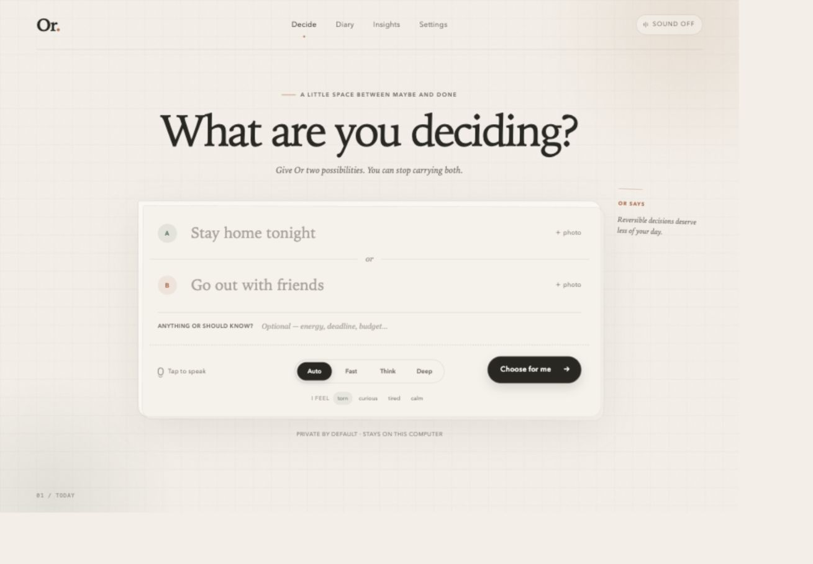
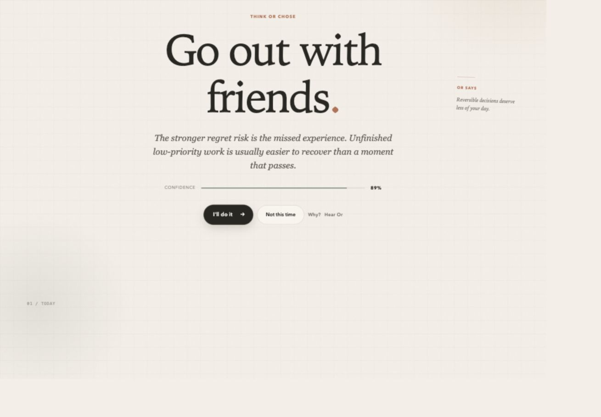
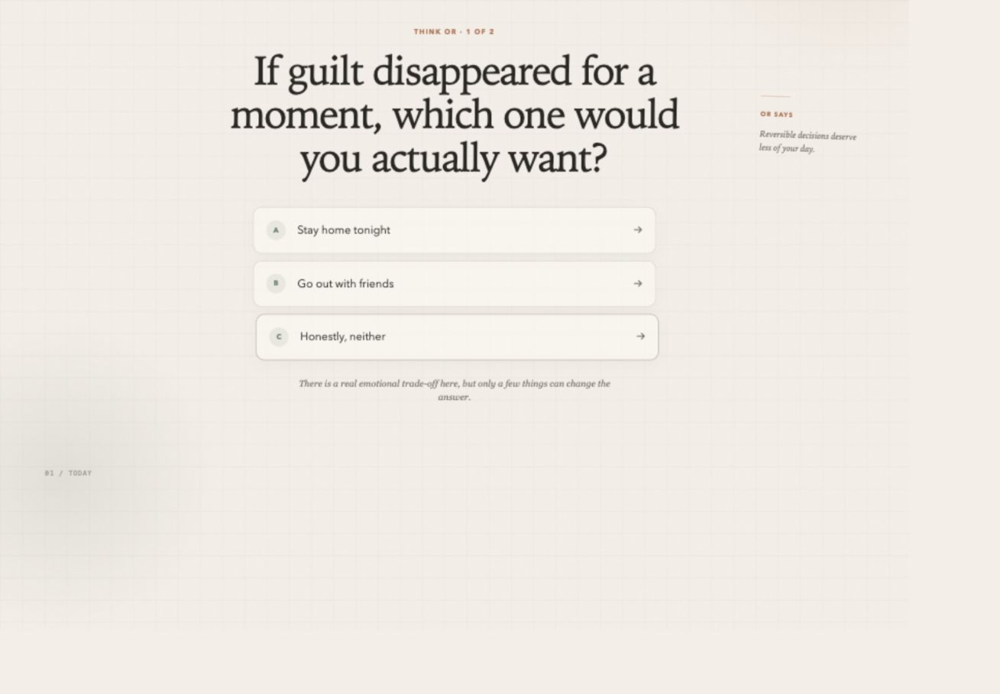
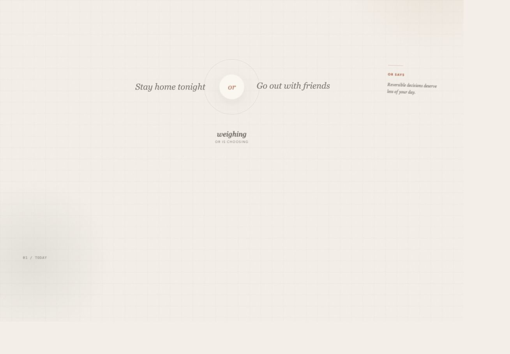
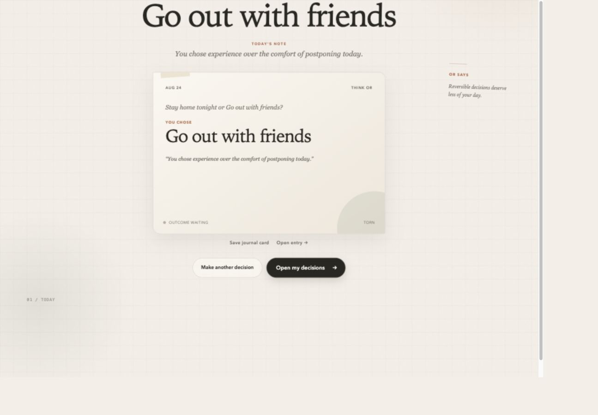
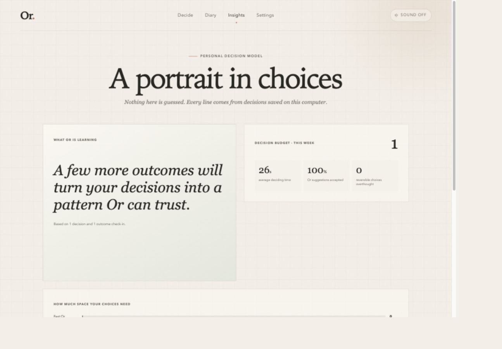

# Or v0.1 产品介绍书

> 一位会替你结束纠结、记住结果，并在下一次更懂你的个人决策伙伴。

版本：v0.1 Local Interactive Web Demo  
交付日期：2026-08-24  
运行方式：本地浏览器 `http://localhost:3000`

---

## 执行摘要

Or 解决的不是“用户不会分析”，而是“用户已经想了太久，却仍然没有行动”。它把一次选择压缩成一个有明确终点的过程：输入两个选项，判断这件事值得思考到什么程度，只问真正可能改变答案的问题，给出一个明确建议，让用户接受或覆盖，然后把真实选择与结果写入 Decision Diary。下一次遇到相似问题时，Or 不再只凭通用模板回答，而会引用用户自己的满意与后悔记录。

这使 Or 区别于三类常见产品：普通 AI Chatbot 擅长展开而不一定收敛；随机选择器能给答案却不会学习；传统决策矩阵足够严谨但启动成本很高。Or 的产品机会，是将“快速结束纠结”“温柔的决策空间”和“基于 outcome 的个人记忆”合成一个低摩擦闭环。

v0.1 已交付为一个不依赖付费 API、不需要账号、数据保存在本机的完整 Web Demo。它包含 Fast / Think / 简化 Deep 三种模式、Decision Ritual、接受与覆盖、真实本地数据库、Diary、Outcome、Reflection、Personal Insights，以及声音、语音、图片和程序化 Journal Card。20 个决策引擎评测样本、43 个单元测试和桌面/移动端核心旅程测试均已保留为可重复检查的证据。

2026-09-30 起，项目在保留确定性规则引擎与无付费 AI API 的前提下，进入公开作品集部署：访客可免登录体验，GitHub OAuth 账户可保存并查看自己的历史；Cloudflare Workers 承载应用，D1 保存结构化记录，D1 私有图片表 保存图片。生产数据只在新建的远程数据库中，不从原本机数据库导入。当前代码已完成身份隔离和存储改造，线上账号、GitHub 仓库与域名仍待外部账户配置。

### 产品一瞥



*首页只保留一个任务：把正在携带的两个可能性交给 Or。*



*一个明确选择、简短理由、confidence，以及接受或覆盖的最终控制权。*

---

## 01｜需求与市场：人缺少的往往不是更多信息

### 1.1 为什么“选择困难”值得被单独解决

日常选择经常同时具备三个特征：客观影响不大、可以反悔，却会持续占用注意力。真正的成本不是选错一杯饮料，而是不断重新打开同一个问题。中等决定则常被 guilt、害怕错过、对未来后悔的想象所放大。用户可能已经知道自己偏向哪一边，只是缺少一个可信的外部动作，帮助自己结束循环。

因此，Or 不把 KPI 设为“分析得更深入”，而是：

- 更快形成一个可执行决定；
- 用最少问题识别真正的心理权衡；
- 记录实际结果，让未来少靠猜；
- 降低决定消耗的时间、注意力和心理能量。

### 1.2 用户真正的痛点

研究阶段把痛点归纳为四层：

1. **启动摩擦**：复杂表单、权重和评分让人还没决定就先放弃工具。
2. **没有 closure**：对话给了很多角度，但用户仍要自己承担最后一步。
3. **反复从零开始**：工具忘记过去，用户也很难从零散记忆中总结规律。
4. **复盘负担过高**：传统日记要求主动书写，往往不能稳定形成 outcome 数据。

对应的 Job to be Done 是：“当我卡在 A 与 B 之间时，在一分钟内帮我形成行动；如果类似情境发生过，用我自己的结果提醒我；之后让我用一次点击完成复盘。”

### 1.3 竞品与邻近方案扫描

项目扫描了 20 个产品或开源项目，覆盖五类能力：

| 类型 | 代表方案 | 已经解决 | 仍留下的空白 |
| --- | --- | --- | --- |
| 决策日志 | Decision Journal App、Decision Journal AI | 记录依据、复盘偏差 | 对日常小选择过重，行动闭环不够快 |
| 结构化决策 | Equinor DOT、Entscheidungsnavi、ChoiceMap | 多准则、权重、可解释比较 | 表格感强，容易制造伪精确 |
| 快速选择 | Picker Wheel、Tiny Decisions、Decide Now! | 即时、低门槛、有仪式感 | 只有随机结果，没有记忆与学习 |
| 数字日记 | Apple Journal、Day One、Reflectly、Daylio、Rosebud | 回看、情绪、照片、个人洞察 | 记录发生过什么，不负责当下做决定 |
| 氛围体验 | Endel、Calm、Portal，以及 Arc / Linear 的交互语言 | 降低焦躁、建立空间感与精致反馈 | 氛围或生产力本身并非决策闭环 |

完整逐项分析见 [Competitive Analysis](./research/COMPETITIVE_ANALYSIS.md) 与 [UX References](./research/UX_REFERENCES.md)。本次调研用于定位和设计选择，不把公开页面无法证明的用户规模或商业表现当作结论。

### 1.4 Or 找到的产品机会

Or 的机会不是做一个更复杂的 decision calculator，而是把三种通常分离的能力连起来：

**当下替用户结束纠结 → 用有情绪的 Diary 保存决定 → 用真实 outcome 改善下一次建议。**

由此形成五个差异点：Decision closure、Outcome-grounded memory、Regret-aware recommendation、Decision Diary，以及不拖延结果的 Ambient ritual。

Or 明确不做开放式聊天、企业协作、心理诊断、专业医疗/法律/投资建议，也不把每个日常选择都改造成权重矩阵。

---

## 02｜产品定义：不是替人思考，而是帮人停止无效思考

### 2.1 Or 是什么

Or 是本地优先的个人决策伙伴。它面向经常在学习、工作、社交、消费和日常安排之间反复纠结的人，尤其适合“已经大致知道自己想要什么，却因 guilt、害怕后悔或信息过载而拖延”的时刻。

核心价值主张可以写成一句话：

> Give the decision the amount of thought it deserves — then close it.

### 2.2 为什么不是普通 AI Chatbot

Chatbot 的默认交互单位是消息，Or 的默认交互单位是一次完成的 Decision。它必须产生明确 recommendation、允许用户作最终选择、保存结果，并在以后回访。对话只是帮助收敛的手段，不是产品终点。

### 2.3 为什么不是 Decision Calculator

评分矩阵假设偏好可以被稳定量化，但日常纠结经常来自情绪许可、可逆性和后悔风险。Or 仍保留解释、trade-off 与 confidence，却避免用过度精确的分数伪装客观真理。用户始终可以覆盖建议，Or 也把 override 当作偏好证据，而不是“答错”。

### 2.4 三种思考预算

**Fast Or** 面向低影响、高可逆的小事。它不追问，直接选择并用一句话结束循环，目标是 5–10 秒完成。

**Think Or** 面向带有 guilt、精力、社交和轻度后悔负担的选择。它最多问两个高信息量问题，例如“明早更可能后悔哪个？”最终输出 recommendation、confidence、why、trade-off 和 regret estimate。

**Deep Or** 面向职业、长期财务、搬迁等高影响选择。v0.1 提供四个定性问题和较谨慎的建议，是可用但有意简化的版本；它不冒充专业顾问，也没有上线复杂 scenario matrix。



*Think Or 不展开长对话，只问可能改变答案的问题。*

### 2.5 核心能力如何连成系统

```text
Ask → Understand → Clarify if useful → Choose → Explain
  → Act → Remember → Review outcome → Learn → Better next time
```

- **Decision Memory** 保存问题、选项、模式、推荐、置信度、理由、最终选择、是否覆盖、时间、outcome 和 reflection。
- **Regret awareness** 不只问“哪个客观更好”，还估计“这个用户更可能后悔错过什么”。
- **Reversibility awareness** 对低影响且可逆的选择主动限制思考预算。
- **Outcome Loop** 用 Loved it / Fine / Regretted it 降低复盘成本。
- **Personal Decision Model** 在 v0.1 中由规则、统计、结构化 memory 与相似度组成；它不会生成虚假的人格诊断。
- **Decision Budget** 展示用户做了多少决定、哪些模式更耗时、哪些可逆问题仍被过度思考。

---

## 03｜体验设计：把“做决定”变成一个安静的空间

### 3.1 首页只保留一个问题

首页的第一视觉焦点是 “What are you deciding?”。用户可以填写 A / B，也可以粘贴包含 “or” 的自然语言。Voice 与图片是输入的增强入口，功能介绍、统计和历史不会抢占首屏注意力。

### 3.2 Digital Journal + Ambient Companion

视觉语言选择了暖纸张、墨色、sage 与 clay 点缀、编辑式 serif 标题、轻微纹理和柔和阴影。目标不是传统 SaaS dashboard，也不是 ChatGPT clone，而是一页可以停下来交出决定的私人手账。

### 3.3 Decision Ritual

点击 “Choose for me” 后，选项不会机械地瞬间切换。1.4 秒的呼吸、漂浮与词语变化构成一个很短的仪式：它让用户感到决定正在被接住，同时严格避免长 loading。系统支持 reduced-motion，动效偏好不会阻碍操作。



### 3.4 声音、语音与图片

- **Ambient audio**：默认关闭，用户点击后才通过 Web Audio API 生成 Focus / Dream / Night 三种本地音景；偏好保存于浏览器，不依赖版权音乐。
- **Voice input**：优先使用 Web Speech API；不支持或权限失败时就地提示，文本输入始终可用。
- **Hear Or**：通过 SpeechSynthesis 朗读最终 recommendation。
- **Photo A/B**：每个选项可上传一张本地图片并预览、移除；v0.1 不假装理解图片，文字描述仍是决策依据。

### 3.5 Diary 而不是 History Table

决定保存后生成一张具有日期、A/B、Or chose、最终选择和 mood 的视觉卡片。Diary 用时间和卡片组织内容，详情页可以补 outcome 与 reflection；Canvas 可把 Decision Card 导出为 PNG。程序化卡片在零预算前提下建立了可分享、可记忆的产品物件。



---

## 04｜最终实现：一条真实可走通的用户旅程

### 4.1 已实现功能

| 环节 | v0.1 实际行为 |
| --- | --- |
| 输入 | A/B、自然语言拆分、语音、图片预览、模式自动/手动选择 |
| 理解 | 分类 category、impact、reversibility，分配 Fast / Think / Deep |
| 澄清 | Fast 0 问、Think 最多 2 问、Deep 最多 4 问 |
| 推荐 | 明确 choice、confidence、reason、trade-off、regret estimate、history note |
| 行动 | 接受推荐或覆盖为另一项；两者都作为真实选择保存 |
| 记忆 | SQLite-compatible D1 数据库记录 Decision、Option、Recommendation、Choice 等 9 类实体 |
| 回看 | Diary 卡片、决定详情、程序化 PNG Journal Card |
| 结果 | Loved / Fine / Regretted、满意度、后悔度、reflection |
| 学习 | 相似历史 outcome 调整后续评分、推荐方向和理由 |
| 洞察 | 真实历史生成模式分布、接受率、耗时、outcome 和 Decision Budget；样本不足不造数字 |



*低样本时 Or 明确说明还需要更多 outcome，而不是用虚假的人格结论填满 Dashboard。*

### 4.2 技术架构

界面使用 React、TypeScript、Tailwind CSS 与 Framer Motion；本地路由和 API 运行在 Next-compatible Vinext 环境。数据层使用 D1 的 SQLite 兼容实现与 Drizzle schema/migration。测试由 Vitest、Playwright 和独立 evaluation runner 组成。

架构有四个清晰边界：

1. UI 只调用统一 provider 与 API，不包含散落的“AI 文案判断”。
2. Decision engine 是可重复测试的纯逻辑，输出稳定、可追溯。
3. 数据库保存原始事实；Insights 从真实历史重新计算，不保存装饰性假数据。
4. 浏览器能力均采用渐进增强，语音或音频失败不会阻断核心闭环。

完整工程说明见 [Architecture](./ARCHITECTURE.md)。

### 4.3 为什么使用 Mock AI

零预算、本地优先和可评测性决定了 v0.1 不调用远程 LLM。`AIProvider` 定义 `classifyDecision`、`generateClarifyingQuestions`、`recommend`、`generateReflection` 与 `summarizePatterns`；`MockAIProvider` 通过关键词、影响程度、可逆性、澄清回答、确定性扰动和历史 outcome 生成动态结果。

Mock 并不意味着把一句话写死在 UI。相同 dilemma 在历史为 Loved 与 Regretted 时会改变推荐方向和理由；分类和问题预算也随文本与模式变化。它的局限是语义相似度较浅、语言覆盖有限、复杂情境理解弱，但优点是完全离线、没有费用、输出可重复、失败可定位。

### 4.4 如何替换为真实 LLM / Vision / 云端能力

未来可以新增 `OpenAIProvider` 或其他 provider，实现同一接口并返回同一结构；UI、数据库与 outcome loop 不需要重写。Vision 可在图片上传边界之后增加描述与属性提取，但必须保留用户可编辑文字。云同步应在本地数据模型之外增加账号、加密和冲突解决层，而不是把本地优先直接替换掉。

---

## 05｜Evaluation：验证的是闭环，不是好看的截图

### 5.1 为什么这样评测

Or 的主要风险不是按钮能否点击，而是不同模式是否给了合适的思考预算、recommendation 是否真正闭环、历史结果是否真的改变未来建议。因此评测分成三层：Decision engine 样本、逻辑单元测试、浏览器端真实旅程。

### 5.2 可追溯评测链路

`/evaluation` 保留四类资产：

- `dataset.json`：20 个带 ID 的样本，覆盖 Fast、Think、简化 Deep、边界输入和 Memory/Outcome；
- `criteria.md`：自动标准、人工标准、通过规则与能力边界；
- `run-evaluation.ts`：直接运行生产使用的 decision engine / Mock AI pipeline；
- `results.json` 与 `report.md`：逐样本真实输入、历史种子、完整输出、断言、错误、汇总与失败分析。
- `e2e-results.json` 与 `ui-review.md`：逐测试浏览器原始结果，以及真实页面人工观察、响应式数据和未覆盖边界。

可用 `pnpm evaluate` 重跑决策样本，或用 `pnpm evaluate:all` 按单元测试 → 浏览器旅程 → 汇总报告的顺序重建整套证据。报告不是手工填数：runner 会读取真实 decision results 与 Playwright stats 后生成。

### 5.3 实际结果

2026-08-24 本地评测结果如下：

| 证据层 | 覆盖 | 结果 |
| --- | --- | --- |
| Evaluation dataset | Fast 5、Think 5、Deep 2、Boundary 4、Memory 4 | 20 / 20 通过，100% |
| Vitest | Decision engine、memory logic、insight pattern | 43 个测试通过 |
| Playwright Desktop | 核心闭环、Accept/Override、验证、PNG Card、图片、Ambient、Voice fallback | 10 个通过，1 个移动专属跳过 |
| Playwright Mobile | 同一产品旅程与响应式行为 | 11 个通过 |

代表性 Memory 样本中，同一个 “Stay home tonight / Go out with friends” 问题在“上次出去且 Loved”时推荐 Go out；在“上次出去且 Regretted”时推荐 Stay home，并产生可见 history note。这证明“过去的结果会改变未来推荐”已在当前规则系统内成立。

### 5.4 失败、边界与诚实结论

本次自动化样本没有失败案例，但 100% 只表示当前合成基准全部满足已声明规则，不等于推荐对所有真实用户都正确。仍存在以下边界：

- 相似度以关键词集合重叠为主，可能把表面相似误作情境相似；
- 合成 dataset 不能验证真实满意度、留存或付费意愿；
- Web Speech API 的支持、语言质量和权限依赖浏览器；
- Deep Or 不是专业决策建模器；
- 医疗、法律、投资等高风险专业选择不在能力范围内。

因此当前结论是：**Pass for local v0.1 demo**。核心分类、问题预算、明确输出、输入验证和 outcome-aware memory 已被验证；真实可用性与商业价值仍需要用户研究。

---

## 06｜开发与迭代：从完整蓝图到可交付产品

### 6.1 初始方案

项目从一个覆盖 Research、PRD、IA、Design System、Decision Engine、Memory、Rich Interaction、Diary、Insights、QA 和 Release 的完整蓝图开始。硬截止加入后，优先级被重新排序为：先保证核心闭环和真实持久化，再增量增加产品感，最后冻结 scope 进行整合验证。

### 6.2 实际调整

- 原计划 Prisma + SQLite 调整为当前脚手架原生支持的 D1-compatible SQLite + Drizzle，减少运行时冲突，同时保留关系模型和 migration。
- Deep Or 保留四个高信息量问题，暂不实现复杂 criteria weighting 和 scenario matrix。
- 图片只做本地上传、压缩预览与卡片素材，不做虚假的视觉理解。
- Ambient sound 使用 Web Audio 合成而非寻找版权音源。
- Decision Card 使用 Canvas 程序化生成而非付费图像 API。
- Playwright 复用本机 Google Chrome，绕开当前 macOS target 无法使用 bundled Chromium 的环境限制。

### 6.3 测试推动的优化

浏览器测试发现首页在 React 水合完成前极快提交会触发原生行为。解决方案是在 hydration 完成前禁用主操作，并让核心按钮使用显式 `type="button"`；随后桌面与移动端旅程重新通过。对声音、语音与动画均采用非阻断 fallback，避免 P1 能力破坏 P0。

最终把桌面与移动 Playwright 项目合并运行时，还发现两个 worker 会同时清理共享的本地 D1，造成移动 Outcome 用例找不到刚创建的记录。项目保留了失败 JSON，将端到端评测改为单 worker 顺序执行后重跑。这个过程验证了 Evaluation Pipeline 的意义：失败不只显示红绿状态，还能留下输入、错误、根因与修复证据。

### 6.4 当前不足与下一版最高价值任务

1. 用语义 embedding 或 LLM rerank 改善相似决定匹配，并向用户解释“为什么这段历史相关”。
2. 进行 8–12 名目标用户的任务测试，测量 time-to-decision、override、复盘完成率和主观减负感。
3. 为 Deep Or 增加可编辑 criteria/weights，但保持非表格化呈现。
4. 将图片迁移到独立 blob/file 存储，数据库只保存 metadata/path。
5. 在获得真实用户证据后，再决定远程 provider、账号与跨设备同步的优先级。

---

## 07｜最终产品故事：Or 如何越来越懂一个人

晚上十点，用户本来准备继续写一项并不紧急的工作，又收到朋友邀请。他打开 Or，首页没有教程和功能墙，只有一句：**What are you deciding?**

他输入 “Stay home tonight” 和 “Go out with friends”。Or 判断这不是一个需要四层矩阵的大决定，而是带有 guilt 与 missed experience 的 Think Or。它问：“明早你更可能后悔哪一个？”用户选择“错过朋友”。

短暂的 Decision Ritual 之后，Or 明确回答：**Go out.** 理由不是空泛鼓励，而是：错过的体验更难恢复，低优先级工作可以补回。用户看到 confidence、trade-off 与 regret estimate，点击 “I'll do it”。页面回答 “It's decided.”，并生成一张带日期和情绪的 Journal Card。

第二天，他在 Diary 打开这张卡，用一次点击记录 **Loved it**，并写下“回来后反而更专注”。这条 outcome 进入 Decision Memory。Insights 不会立刻用一条数据给他贴人格标签，而是随着样本积累，逐步展示他在社交、工作和可逆决定上的真实倾向。

几周后，相似选择再次出现。Or 不再像第一次那样完全从通用规则出发，而会提示：“上次你选择出去，并且庆幸自己去了。”推荐仍可被覆盖，但此刻用户面对的不是另一个陌生 AI 的意见，而是自己过去结果形成的证据。这就是 Or 从一次工具使用变成个人决策伙伴的关键。

---

## 08｜商业化与未来路线：把证据、假设和可能性分开

### 8.1 已经验证

- 本地 Web 形态可以完成输入、推荐、接受/覆盖、保存、回看、Outcome 和下一次 memory influence 的完整闭环。
- Fast / Think 的不同问题预算能够由规则稳定执行。
- Diary、Ambient、Voice、Photo 与 Card 可以在不依赖付费 API 的情况下组合成统一体验。
- 当前技术边界允许未来替换 provider，而不必重写整个产品旅程。

### 8.2 当前假设，尚待验证

- 用户会认为“明确选择 + 简短理由”比开放式长回答更减负。
- Decision Diary 能提高 outcome 回访率，而不只是视觉装饰。
- 用户愿意让历史 outcome 参与后续建议，并认为这种个性化可信。
- 一部分重度用户愿意为跨设备、更强 Personal Model 或高级复盘付费。

这些只能通过真实用户任务、留存和支付实验验证，不能从本 Demo 的自动化通过率推出。

### 8.3 合理的商业方向

**Freemium / Subscription** 可以保留 Fast Or、基础 Diary 和有限历史为免费层；订阅层提供长期 Personal Decision Model、跨设备加密同步、高级 Insights、更多导出和可选真实 AI。前提是先证明回访价值，而不是先堆付费墙。

**更强 LLM / Vision** 可以改善自然语言理解、相似情境匹配、图片属性提取和 Deep Or 情景分析。高风险领域必须提供明确边界与人工专业建议入口。

**Mobile App** 更符合决定发生的即时性，也能利用通知进行低频 outcome check-in；但应在 Web 版验证核心留存后投入。

**情侣 / 朋友共同决策** 可扩展为各自表达偏好、发现真实冲突与记录共同结果，但这是一条新的多人产品线，需要隐私、身份和冲突设计，不能直接套用单人模型。

**分享与传播** 可从可控的 Decision Card 导出开始，而不是公开社区。卡片天然具备传播物件属性，但默认应保护私人决定。

**B2C 之外的场景** 可能包括教练、教育或团队复盘，但企业决策、医疗和投顾需要不同的合规与工作流，不属于当前产品已验证的自然延伸。

### 8.4 建议路线

```text
v0.1  本地完整闭环与可评测规则系统（已完成）
  ↓
v0.2  真实用户测试 + 语义 memory + outcome 提醒
  ↓
v0.3  可选真实 AI Provider + 加密同步 + 移动体验
  ↓
v1.0  由留存证据决定订阅、协作或更专业场景
```

---

## 结语

Or 最有价值的部分不是替用户做出一个永远正确的决定。它承认决定包含不确定性，也承认用户拥有最终选择权。它真正提供的是一种更健康的节奏：给问题恰好足够的思考，结束它，去生活，然后从结果中学习。

这也是 Or 的产品承诺：**Less looping. More living.**

### 相关交付物

- [PRD](../PRD.md)
- [Evaluation Report](../evaluation/report.md)
- [Evaluation Criteria](../evaluation/criteria.md)
- [Architecture](./ARCHITECTURE.md)
- [Design System](./DESIGN_SYSTEM.md)
- [Decision Log](./DECISIONS.md)
- [Current Status](../STATUS.md)
